# OY Player features

Everything OY Player 0.15.0 does, group by group, with the key for it where there is one.
Every key can be changed in Settings › Controls › Keys. The pictures are taken by the player
itself from test clips (`tools\selftest.cmd` with `tests\next-run-features`, see
[How the pictures are made](#how-the-pictures-are-made)).

- [Watch](#watch)
- [Cut](#cut)
- [Draw](#draw)
- [Screenshot](#screenshot)
- [Listen and radio](#listen-and-radio)
- [Organise: playlist, history, series](#organise-playlist-history-series)
- [Look: themes, colour, skins, languages](#look-themes-colour-skins-languages)
- [Settings](#settings)
- [Windows integration](#windows-integration)
- [Privacy and updates](#privacy-and-updates)
- [Keys](#keys)

## Watch

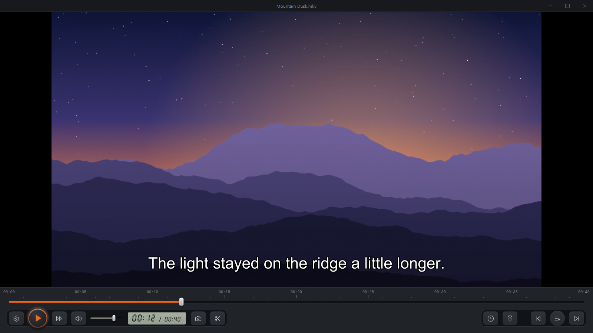

- **Plays almost anything.** Local video and sound files and network streams, through libmpv
  with hardware decoding (Settings › Playback › Decoding). Video: MKV, MP4, AVI, MOV, WMV, WebM,
  FLV, M4V, TS, M2TS, MTS, MPG, MPEG, VOB, 3GP, OGV, RM, RMVB, DivX, ASF. Sound: MP3, FLAC,
  M4A, AAC, OGG, Opus, WAV, WMA, APE, WV, MKA, AC3, DTS, MPC, TTA, ALAC, AIFF, MIDI.
- **Opening.** Drag files or a folder onto the window, click the empty window, press **F2**, or
  copy a file in Explorer, a path or a web address and press **Ctrl+V**. With nothing loaded the
  Play key opens a file too; its right click always does.
- **YouTube and other sites.** A link to a page that yt-dlp knows plays in the window. The first
  time the player asks before downloading yt-dlp and Deno (about 65 MB) from their GitHub
  releases, checks each against its published SHA-256, then yt-dlp updates itself once a week.
  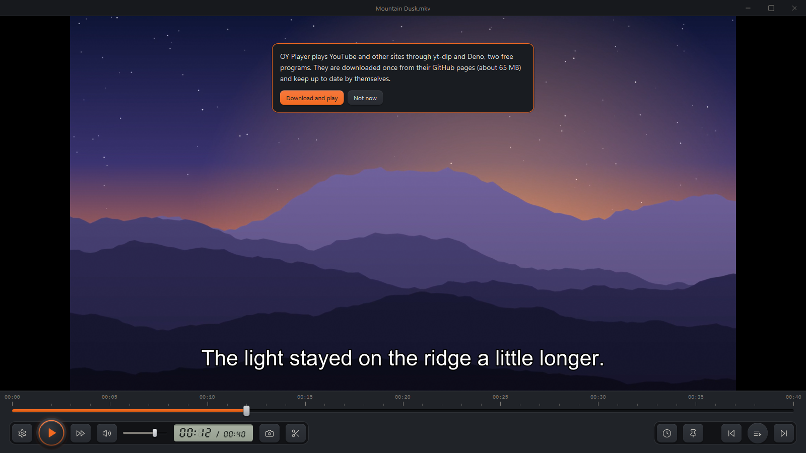
- **Play and pause** — **Space** or a click on the picture (Settings › Controls can make the click
  hide the panels instead, or do nothing). **Stop** — **Alt+V** (pause and back to the start).
  **To the start** — **Backspace**.
- **Seeking.** **←/→** 5 s, **Shift+←/→** 30 s (both steps set in Settings › Controls),
  **Ctrl+←/→** one frame back or forward. The wheel over the seek bar does the same: plain 5 s,
  with Shift 30 s, with Ctrl a frame. Over the picture the wheel is the volume or seeking, as set.
- **Frame preview over the seek bar.** Point at the bar and a frame from that place shows above
  the pointer; a second hidden decoder makes it, so playback is never disturbed.
  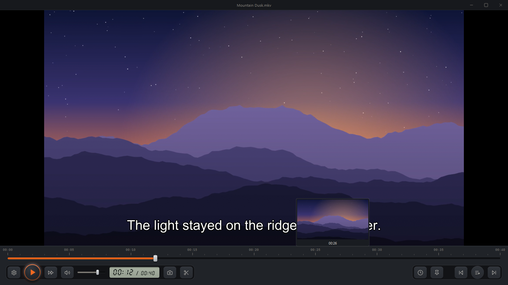
- **Speed.** **Ctrl+X** steps through 1×, 1.5×, 2× and 4×; the fast-forward key's right click
  opens the speed menu (0.25× to 4×). A speed other than 1× shows on the time display; a click
  on it goes back to 1×.
  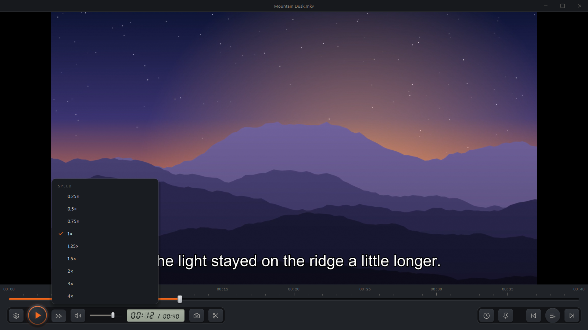
- **The time display** is a seven-segment LCD: a click switches elapsed and remaining, a right
  click copies the time shown.
- **A-B repeat** — **\\** sets the start, **\\** again the end, a third press turns it off; the
  loop is marked on the seek bar.
  
- **Resume.** **L** continues a file where it was left; Settings › Playback › «Resume where you
  stopped» does it by itself. Each file also comes back with its own audio track, subtitles and
  volume («Remember the tracks and volume of each file», on by default).
- **Full screen** — **Enter**, a double click or the middle button on the picture. In full screen
  the panels go at once and come back only when the mouse really moves. **Esc** leaves it.
- **Window.** Always on top — **A** (never / always / while a video plays, in Settings),
  minimize — **End**, window size 50/100/150/200 % — **Alt+1…4** (**Home** = 100 %). The window
  can fit itself to each video («Window fits the video»). The mouse's back and forward buttons seek
  or change the file.
- **The picture's right-click menu**: open, speed, subtitles, sound, video properties,
  screenshot, file information.
  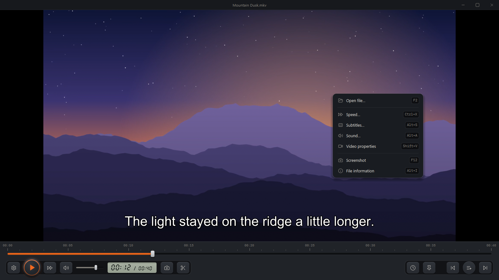
- **Video properties card** (**Shift+V**): aspect (as is, 16:9, 4:3, 2.35, fill), zoom and
  rotation, brightness, contrast and saturation, and the filters sharpen, denoise, deinterlace,
  black and white and negative. The same from keys: aspect **Shift+\`** / **Shift+1…5** /
  **Num .**, zoom **=** / **-**, reset **Alt+\`**, pan **Num 4/6/8/2**, brightness **Shift+Num ±**,
  contrast **Ctrl+Num ±**, saturation **Alt+Num ±**, reset colour **Num \***.
  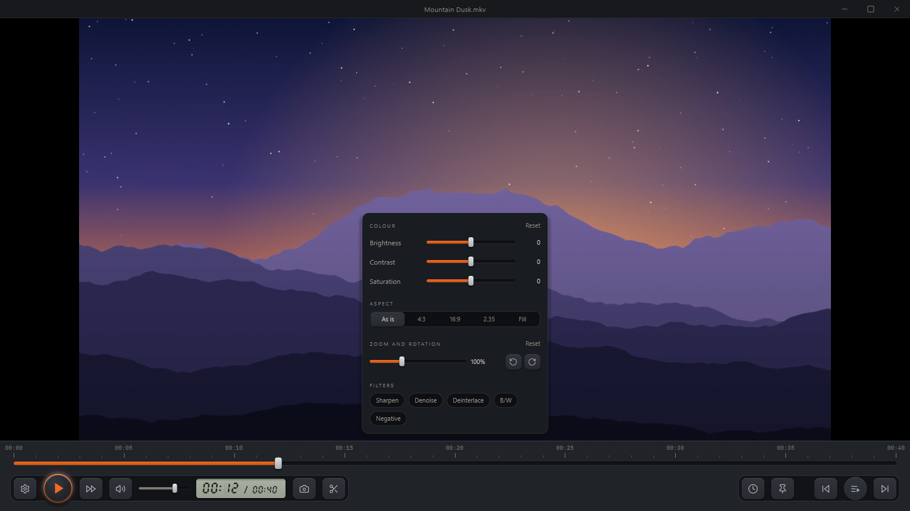
- **Subtitles.** Shown or hidden with **S**; **Alt+S** or the picture's menu opens their menu:
  the track, second subtitles, load from a file (**Shift+S**), earlier or later by 0.1 s
  (**Alt+←/→**), larger or smaller, copy the current line. **Shift+/** goes to the next track,
  **Ctrl+,** and **Ctrl+.** make them slower or faster. Subtitle files are also found in
  folders named `subs`, `Subs` or `subtitles` next to the video (Settings › Subtitles).
  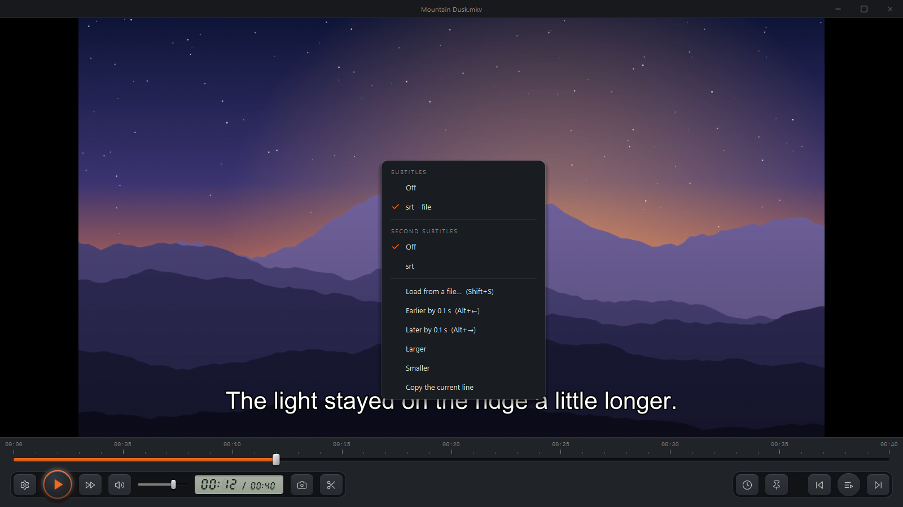
- **Tracks in your language first.** Audio and subtitle tracks in the interface's language are
  chosen first, then English; both lists can be set by hand.
- **File information** (**Alt+I**): container, size, duration, bit rate, tags, chapters, and each
  video, audio and subtitle stream, with a Copy key. **Q** shows a technical overlay with the
  decoder and dropped frames.
  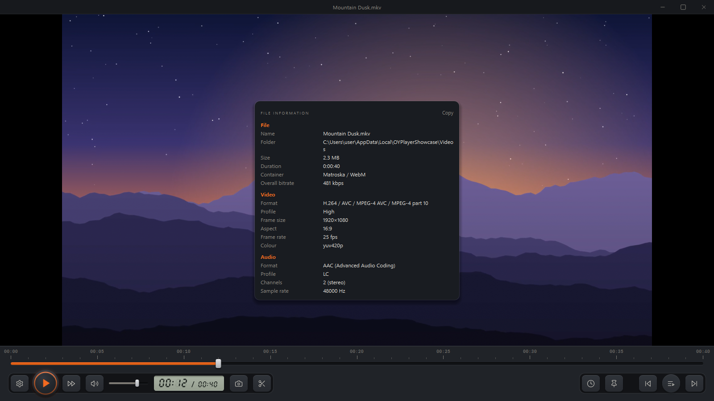
  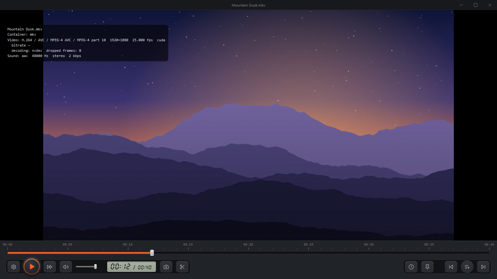
- **Scheduler** (**Shift+T**, the clock key): pause, close the player, sleep or shut down the
  computer now, after this file, when the list ends, or in 15, 30, 60, 90 or 120 minutes. Sleep
  and shut-down come after a 30-second countdown that **Esc** cancels. Settings › Playback ›
  «When the list has played» is the standing version.
  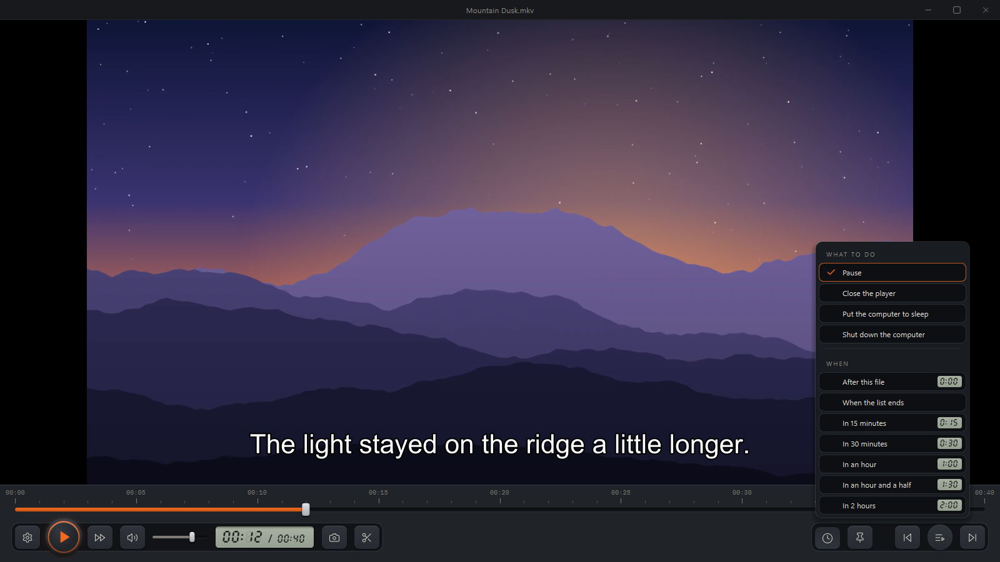
- **Skipping openings and credits.** Mark them once in one episode — **Alt+E** the opening's start,
  **Shift+E** its end, **Shift+O** the start of the credits, or the seek bar's right click — and
  they are skipped in every file of that folder of about the same length. **Alt+O** turns
  skipping on and off.
  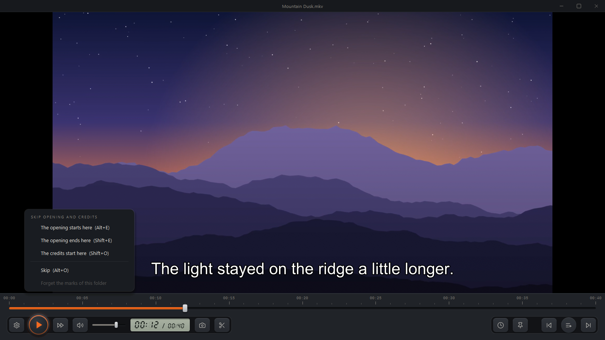
- **Light theme.** A warm cream theme beside the dark one, or the one Windows uses.
  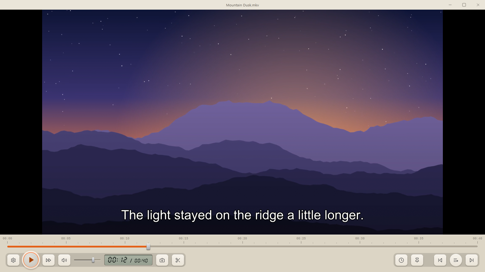

## Cut

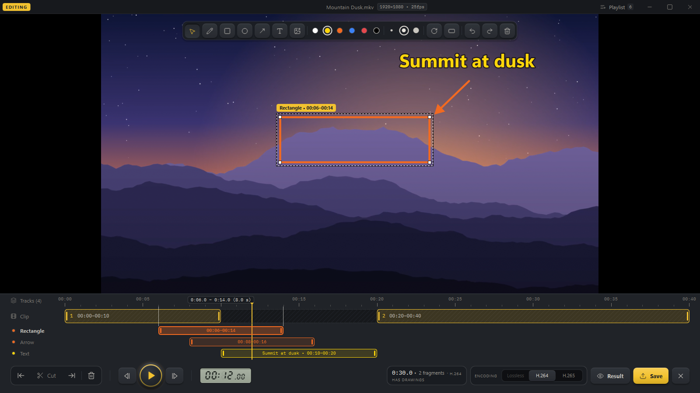

**Ctrl+E** opens the editor on the file being watched; it holds the whole file from the start.

- **I** cuts off what is before the current place, **O** what is after, **X** (the scissors)
  splits the piece in two, **Delete** takes the chosen piece out. Pressing again only moves the
  border. The right click on the bin starts over.
- **Fragments from several files** can make one video; on the clip track **Ctrl+Shift+←/→** moves
  the chosen fragment earlier or later.
- **Lossless by default.** Saving copies the streams without re-encoding where it can; a border
  then moves to the keyframe before it as soon as that is known, so what the timeline shows is
  what is saved. H.264 and H.265 are exact to the frame (an NVIDIA card speeds them up). The edit
  strip says why a save has to re-encode (drawings, a picture, different formats, a turn).
- **Result** (**Shift+Space**) plays the finished video from its start, with a bar of where in
  it you are.
- **Undo and redo** — **Ctrl+Z** / **Ctrl+Y**, for every cut, drawing and change.
- **Turn the picture** a quarter clockwise — **Ctrl+R**.
- **The frame**: as it is, 16:9 over a blurred copy of the picture, or 16:9 cut to fill — a phone
  video becomes a widescreen one.
  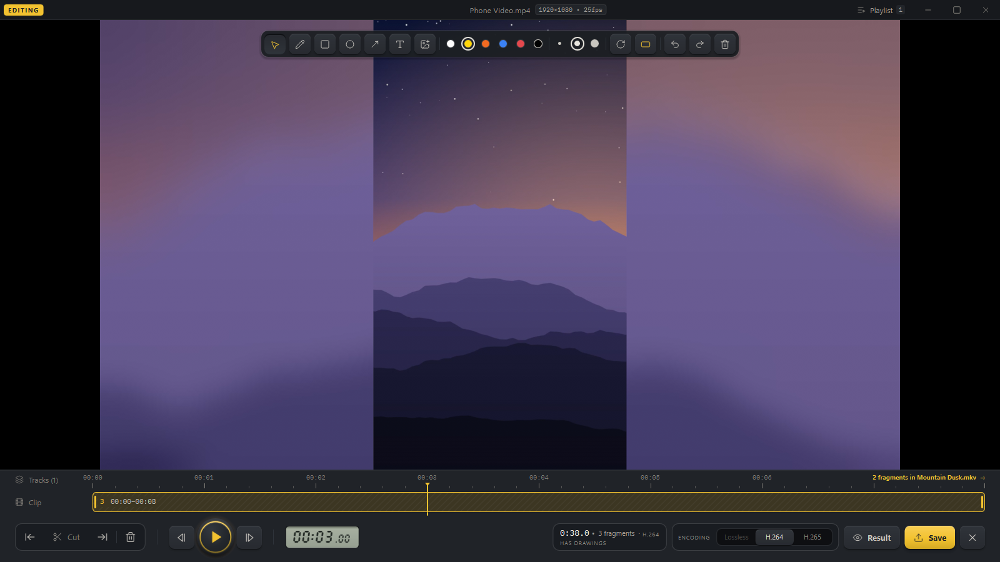
- **Save** — **Ctrl+Shift+S** saves next to the source at once; the right click is «Save as…».
  The source file is never overwritten. Saving can be cancelled; failures (no space, no access,
  a file held by another program) are said in words.
- While editing the title bar shows the EDITING badge, the picture's size and frame rate and a
  Playlist key with the number of files. **Esc** closes the editor; the edit stays for **Ctrl+E**.
  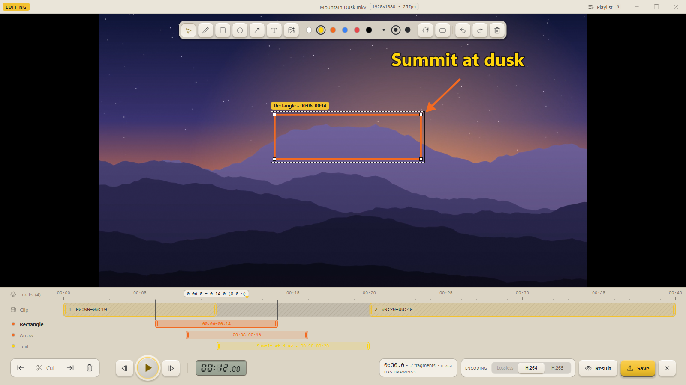

## Draw

Drawings go over the picture in the editor and are burnt into the saved video.

- **Tools** over the middle of the picture: choose and move, pencil, rectangle, circle, arrow,
  text, and a picture (a logo or any PNG, JPG, WEBP, BMP or GIF; dropping the file on the frame
  works too). An inserted picture can be moved, stretched by its corners and made 60 % or 30 %
  opaque.
- **Six inks** (white, yellow, orange, blue, red, black) and **three line widths** (thin,
  medium, thick).
- **Each drawing has its own time.** It gets a track on the timeline named after it with a dot
  of its ink; its bar's ends set when it appears and goes. **[** and **]** set the chosen
  drawing's start and end at the current place, **Tab** / **Shift+Tab** go through the drawings
  on the frame, **Delete** removes the chosen one.
- A chosen drawing shows its name and times on a plate; a rectangle's corners and an arrow's ends
  can be dragged. Drawing pauses the video.

The picture at the top of [Cut](#cut) shows a rectangle, an arrow and a caption with their
tracks.

## Screenshot

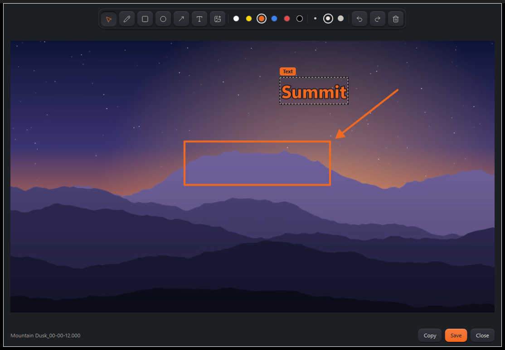

- **F12** saves the frame to the screenshots folder (PNG or JPG, Settings › Screenshots and
  editing) without stopping the video; the file name shows for three seconds with «Open the
  folder». **Ctrl+F12** or the screenshot key's right click copies the frame to the clipboard;
  **Ctrl+S** opens the folder.
  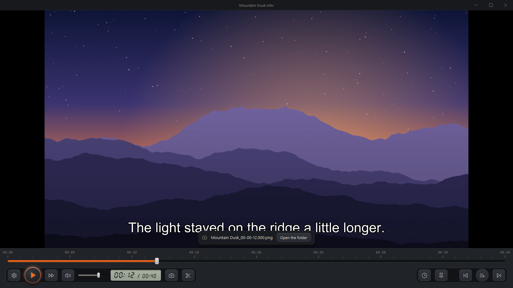
- **Open to draw on** (Settings › Screenshots and editing › Screenshot key): the frame opens alone
  in its own window, without a timeline, with the editor's tools — arrows, rectangles, circles,
  lines, text and pictures, the same inks and widths, undo and redo. Then Copy, Save or Close
  (closed, nothing is saved). Pressing the key again while drawings are on it brings the window
  forward and keeps them.
- A screenshot that cannot be saved (a folder without rights, a full disk) says so and leaves no
  empty file.

## Listen and radio

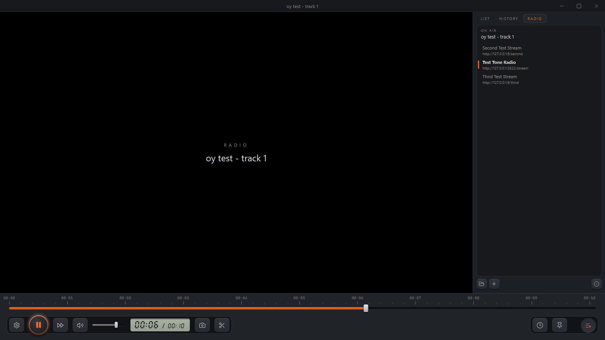

- **Sound menu** (**Alt+A**, the sound key's right click): the audio track, load one from a file
  (**Shift+A**), processing (normalization, EBU R128 normalization, compressor, speech
  leveler), the output device, sound earlier or later by 0.1 s (**Num −** / **Num +**), and the
  pitch up or down by a semitone or back to the original. **/** goes to the next track, **M**
  mutes, **↑/↓** change the volume.
  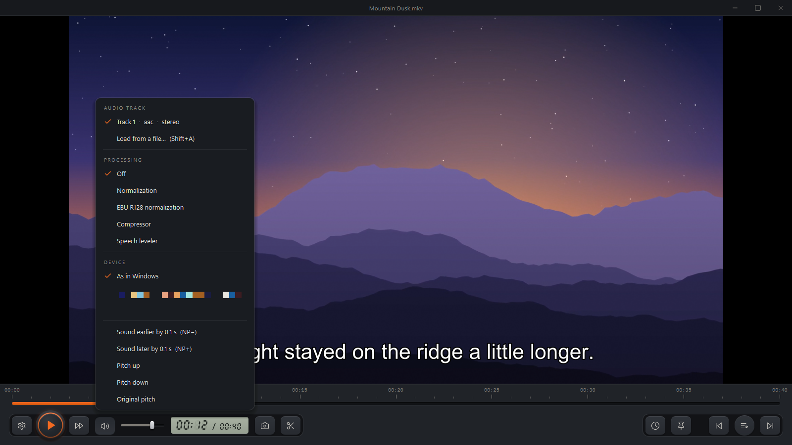
- **Volume above 100 %** up to the maximum set in Settings › Sound (200 % by default).
- **Output**: the device, the channels (as is, stereo, 5.1, 7.1) and passing Dolby and DTS to a
  receiver over HDMI or S/PDIF.
- **Internet radio** (**Ctrl+F2**, the playlist's Radio tab): stations are `.lau` files in the
  stations folder; a new one is added with **+** from a stream address. A playing station shows
  ON AIR and the title it announces. A station that drops is reconnected.
- **Recording** the broadcast to a file as it comes, without re-encoding, into Music\OY Player
  (the folder can be changed). The key is on the radio page; «Radio: record» can be given a key.

The radio picture shows a local test tone served the way a station serves its stream.

## Organise: playlist, history, series

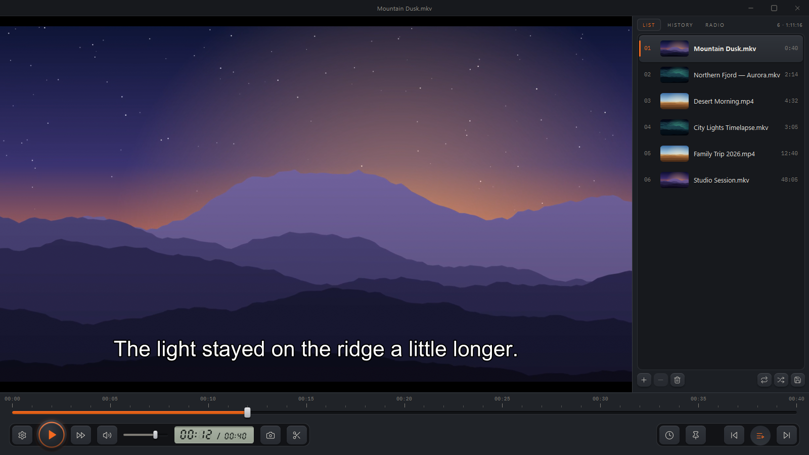

- **Playlist** (**P**): a frame of each file, its number and length; drag files or a folder in.
  **PageUp** / **PageDown** previous and next, **Insert** add files, **Shift+Insert** add a
  folder, **Delete** remove, **Shift+Delete** clear (the key on the list asks twice),
  **Ctrl+↑/↓** move a row, **Ctrl+Home** sort by name, **Ctrl+Enter** play the selected one.
  **R** repeats the list, **Shift+R** one file. The keys under the list add, remove, clear,
  repeat, shuffle and save the list as an m3u8 file.
- **The list holds only the opened file** by default; Settings › Playback › The list › «Every
  opened file» keeps them all, one after another.
- **Next episodes.** Open one episode and the next ones from the same folder line up after it:
  names that differ only by a number (`Show S01E01 Pilot`, `Show S01E02 The Return`) are one
  series; `Movie A` and `Movie B` are not.
- **History** (**Ctrl+H**, the History tab): files watched for longer than 30 seconds, newest
  first, each once, with how much of it was watched. A double click plays one; a row can be
  removed and the history cleared. Streams stay out of it; it can be turned off.
  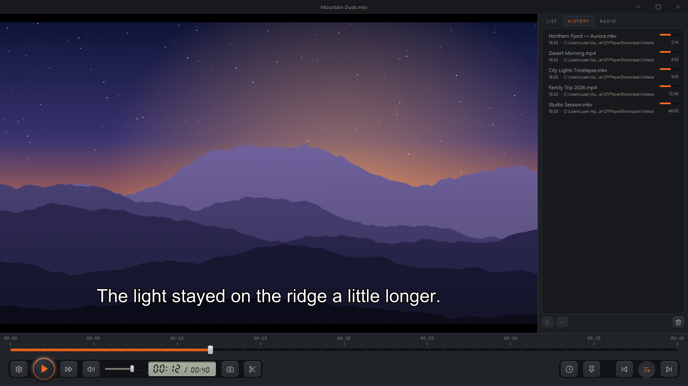
- **The list, the volume and where a film stopped** are kept for the next start, also when Windows
  restarts, shuts down or signs out while it plays.
- **Keyboard areas.** **F6** / **Shift+F6** hand the arrow keys to the list or the edit strip; the
  lists, menus and edit strip are read by screen readers.

## Look: themes, colour, skins, languages

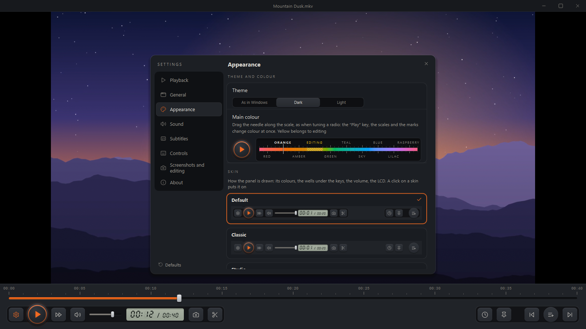

- **Themes**: dark, warm cream light, or as Windows has it (Settings › Appearance › Theme).
- **Main colour**: a dial tuned like a radio — red, orange, amber, green, teal, sky, blue, lilac,
  raspberry. The Play key, the scales and the marks change at once; yellow belongs to editing.
  
- **Skins**: Default, Classic and Studio, each shown by its own panel. A skin is a sealed, signed
  `.oyskin` file; a damaged or changed one is skipped and never stops the player.
  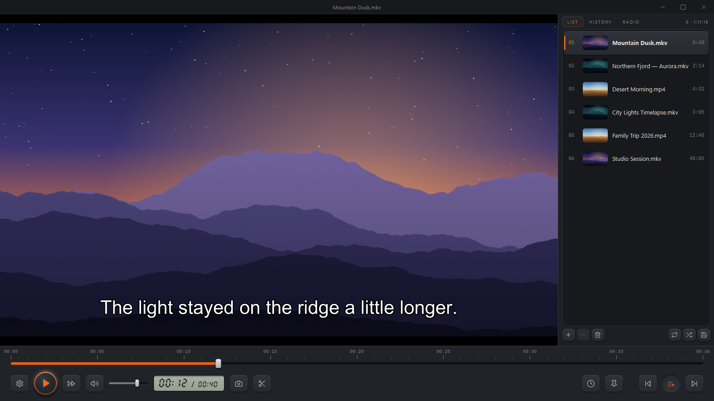
  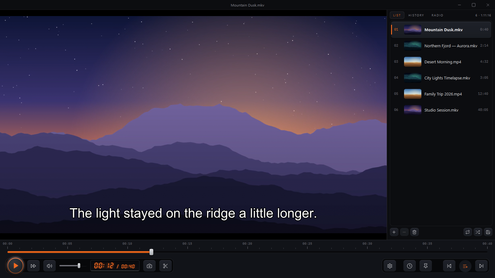
- **39 languages**, each listed by its own name: Arabic, Bulgarian, Chinese (Simplified and
  Traditional), Croatian, Czech, Danish, Dutch, English, Estonian, Finnish, French, German, Greek,
  Hebrew, Hindi, Hungarian, Indonesian, Italian, Japanese, Korean, Latvian, Lithuanian, Norwegian
  Bokmål, Persian, Polish, Portuguese (Brazil and Portugal), Romanian, Serbian (Latin), Slovak,
  Slovenian, Spanish (Spain and Latin America), Swedish, Thai, Turkish, Ukrainian and Vietnamese.
  The player starts in the one closest to Windows'. Arabic, Persian and Hebrew mirror the window
  (the timeline keeps running left to right); every script is drawn in the Windows font made for
  it. Setup speaks 25 of them.
  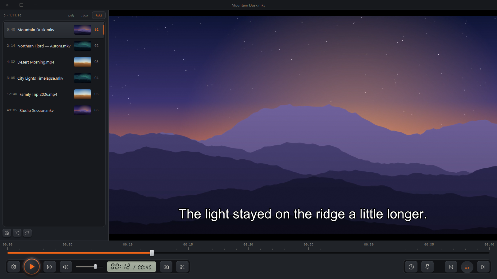
  
- The panel: hardware-style keys with a lit play knob, a seven-segment LCD, line icons drawn for
  the screen's scaling, three key sizes that grow with the window, rounded corners in Windows 11.

## Settings

**F10** or the settings key. Seven sections and About; each row is a name, one sentence and its
control. «Defaults» puts the open section back (a second press confirms). The settings window can
be moved by its top strip.

| Section | What is there | Picture |
|---|---|---|
| Playback | resume, per-file tracks and volume, the list, next episodes, skipping, when the list has played, history, hardware decoding | [settings-playback](screenshots/settings-playback.png) |
| General | language, always on top, window fits the video, one player, updates, tray icon, default player, file icons | [settings-general](screenshots/settings-general.png), [lower part](screenshots/settings-general-windows.png) |
| Appearance | theme, main colour, skins | [settings-appearance](screenshots/settings-appearance.png), [skins](screenshots/settings-appearance-skins.png), [light](screenshots/settings-appearance-light.png) |
| Sound | device, channels, Dolby/DTS passthrough, processing, maximum volume, audio language, radio and recordings folders | [settings-sound](screenshots/settings-sound.png) (device names blurred) |
| Subtitles | show subtitles, size, language, subtitle folders | [settings-subtitles](screenshots/settings-subtitles.png) |
| Controls | click, double click, middle and side buttons, wheel, frame preview, media keys everywhere, seek steps, the key editor | [settings-controls](screenshots/settings-controls.png), [keys](screenshots/settings-controls-keys.png) |
| Screenshots and editing | screenshot key, folder, format and JPG quality, how the edit is saved, mpv options | [settings-screenshots-editing](screenshots/settings-screenshots-editing.png) |
| About | version, update, the project's site, thanks, where settings are kept | [settings-about](screenshots/settings-about.png) |

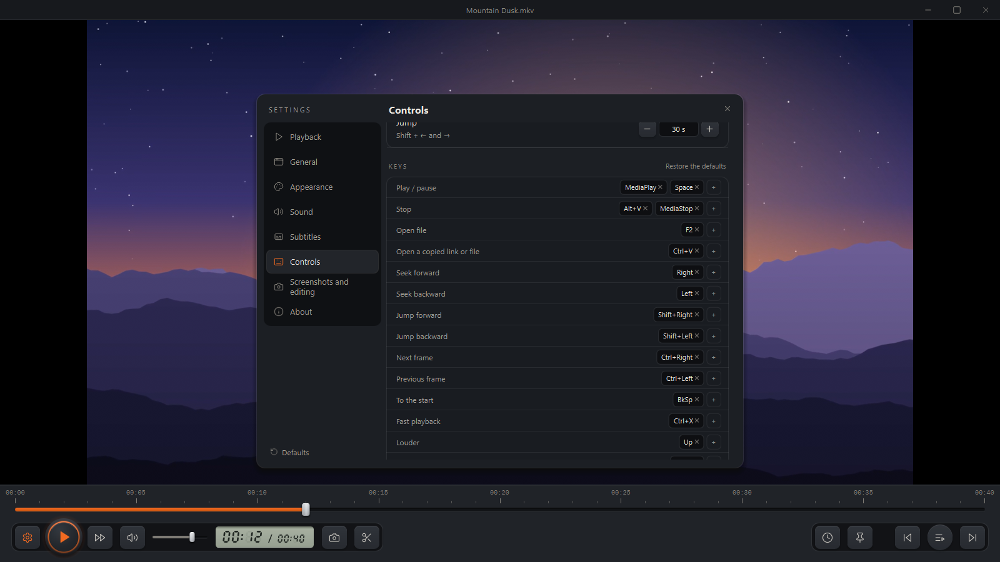

- **Key editor**: every command with its keys; a click on a key and the next key pressed is the
  new one, **Esc** cancels; «Restore the defaults».
- **mpv options** for those who need more: `name=value` lines, as in `mpv.conf`, applied at once.

## Windows integration

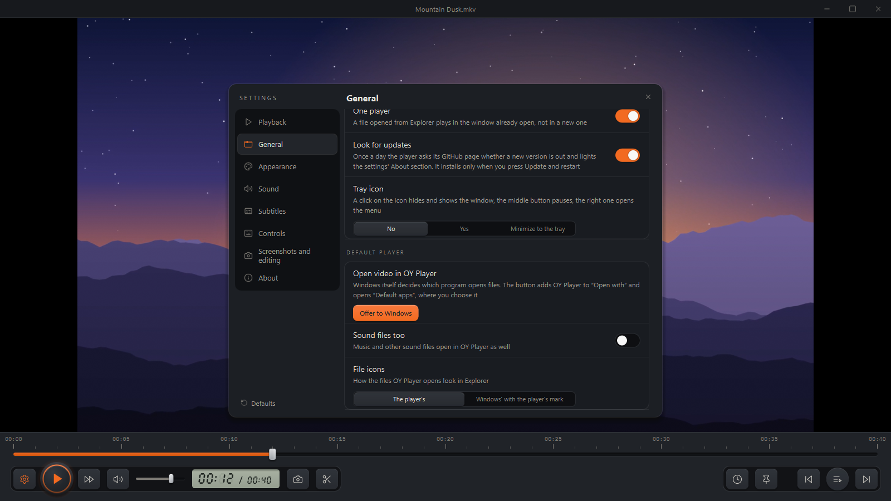

- **Default player on request.** «Offer to Windows» adds OY Player to «Open with» and to Windows'
  Default apps for video files, with «Sound files too» for music, and opens Default apps where the
  choice is made; «Remove» takes it all away (the uninstaller does too). Nothing is registered
  without asking.
- **File icons**: the player's own, or Windows' video and sound icons with the player's mark in
  the corner.
- **One player.** A file opened from Explorer plays in the window already open; several files
  opened together go into one list in their folder's order.
- **Tray icon** (off / on / minimize to the tray): a click shows or hides the window, the middle
  button pauses, the right one opens Show / hide, Next, Previous, Exit.
- **Media keys** work while the player has the focus, and from any program with «Media keys
  everywhere».
- **Snap Layouts** on the maximize key in Windows 11.
- **Network folders** (`\\server\share`) work for subtitles, sound tracks, saved edits and
  lists.
- **Install**: a per-user installer without administrator rights, Windows 10 1809 or later; a new
  version installs over the old one.

## Privacy and updates

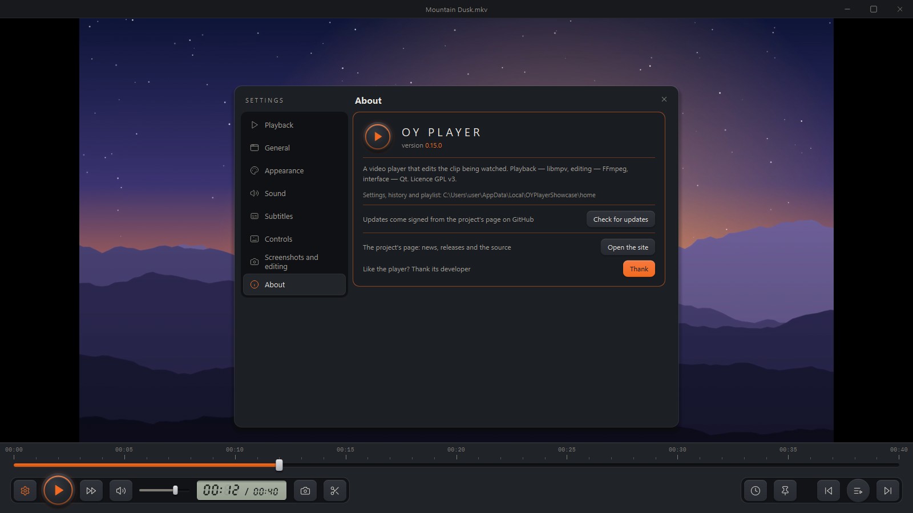

- **No account, no telemetry.** The player itself goes online for three things only: the daily
  look for a new version, YouTube-style links (after you agree to download yt-dlp and Deno, and
  their weekly self-update), and the streams you open.
- **Updates**: once a day the player asks its GitHub release page whether a newer version is out
  and lights the About section (Settings › General › «Look for updates» turns this off). Nothing
  installs until you press «Update and restart»; the installer must carry the release key's
  signature, checked by Windows, or it is deleted unrun.
- **Your files stay yours**: an edit never overwrites its source; settings, history and the list
  are kept in `%LOCALAPPDATA%\OYPlayer`.
- Free software under GPL v3; playback by libmpv, editing by FFmpeg, interface by Qt.

## Keys

The defaults; Settings › Controls › Keys changes any of them. «Num» is the numeric keypad.

| Key | Does | Key | Does |
|---|---|---|---|
| Space | Play / pause | Alt+V | Stop |
| F2 | Open file | Ctrl+V | Open a copied link or file |
| ← / → | Seek 5 s | Shift+← / → | Jump 30 s |
| Ctrl+← / → | Previous / next frame | Backspace | To the start |
| Ctrl+X | Fast playback | L | Resume where it stopped |
| ↑ / ↓ | Louder / quieter | M | Sound on/off |
| Enter | Full screen | Esc | Close (one thing per press) |
| A | Always on top | End | Minimize |
| Alt+1…4, Home | Window 50–200 %, 100 % | \\ | A-B repeat |
| P | Playlist | PageUp / PageDown | Previous / next file |
| Insert / Shift+Insert | Add files / folder | Delete / Shift+Delete | Remove / clear the list |
| Ctrl+↑ / ↓ | Row up / down | Ctrl+Home | Sort the list |
| R / Shift+R | Repeat list / file | Ctrl+Enter | Play the selected one |
| Ctrl+H | History | Ctrl+F2 | Internet radio |
| Shift+T | Scheduler | F10 | Settings |
| F12 | Screenshot | Ctrl+F12 / Ctrl+S | Frame to clipboard / screenshots folder |
| Shift+V | Video properties | Q | Technical OSD |
| Alt+I | File information | Num . | Cycle aspects |
| Shift+\` / Shift+1…5 | Aspect as is / 16:9, 4:3, fill, fill, 2.35 | = / - / Alt+\` | Zoom in / out / reset |
| Num 4/6/8/2 | Pan | Num \* | Reset colour |
| Shift+Num ± | Brightness | Ctrl+Num ± / Alt+Num ± | Contrast / saturation |
| S | Subtitles on/off | Alt+S | Subtitle menu |
| Shift+S | Load subtitles | Shift+/ | Next subtitle track |
| Alt+← / → | Subtitles earlier / later | Ctrl+, / Ctrl+. | Subtitles slower / faster |
| Alt+A | Sound menu | Shift+A | Load an audio track |
| / | Next audio track | Num − / Num + | Sound earlier / later |
| Alt+E / Shift+E | Opening start / end | Shift+O | Credits start |
| Alt+O | Skipping on/off | F6 / Shift+F6 | Keys to the next / previous area |
| Ctrl+E | Editor | I / O | Cut off before / after here |
| X | Cut here | Delete | Take the chosen piece or drawing out |
| Shift+Space | Result (preview) | Ctrl+Shift+S | Save the edit next to the source |
| Ctrl+Z / Ctrl+Y | Undo / redo | Ctrl+R | Turn the picture |
| Tab / Shift+Tab | Next / previous drawing | [ / ] | Drawing starts / ends here |
| Media keys | Play, next, previous, stop | | |

Without a default key, ready to be given one: remove a list row, shuffle, Edit: the whole file,
Edit: save as…, pitch up / down / original, Radio: record.

## How the pictures are made

The player takes them of itself: `tests\next-run-features` (an empty file) and then
`tools\selftest.cmd` run `src\oyplayer\showcase.py` (`Features`) on monitor 3, silent and without
focus, on painted test clips, and write `tests\out\showcase\*.png` at the window's size,
1600 × 900. The run's settings, screenshots and clips live in `%LOCALAPPDATA%\OYPlayerShowcase`,
so the pictures show an ordinary install's paths. The names of the sound devices of the
computer that took them are blurred.
