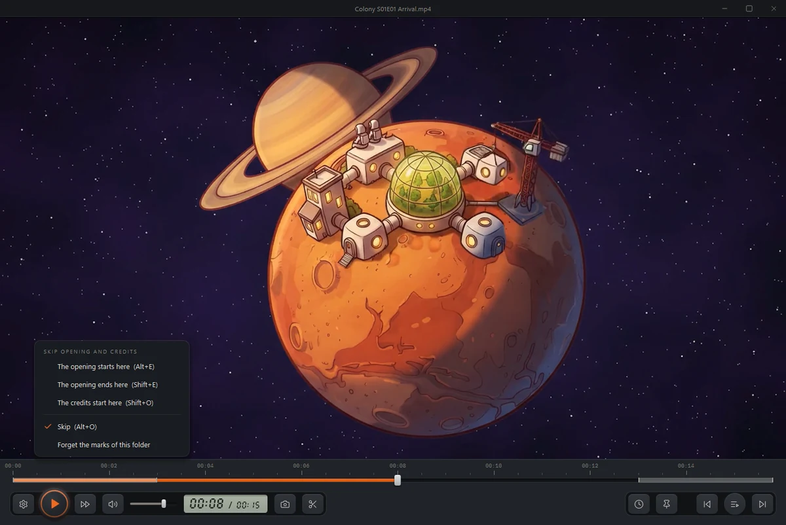
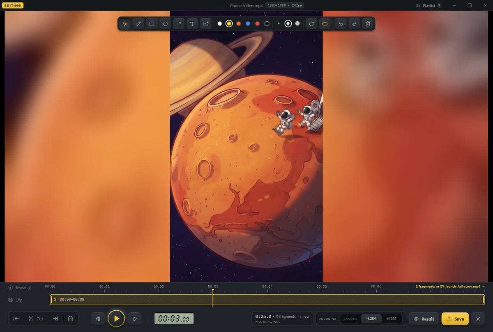
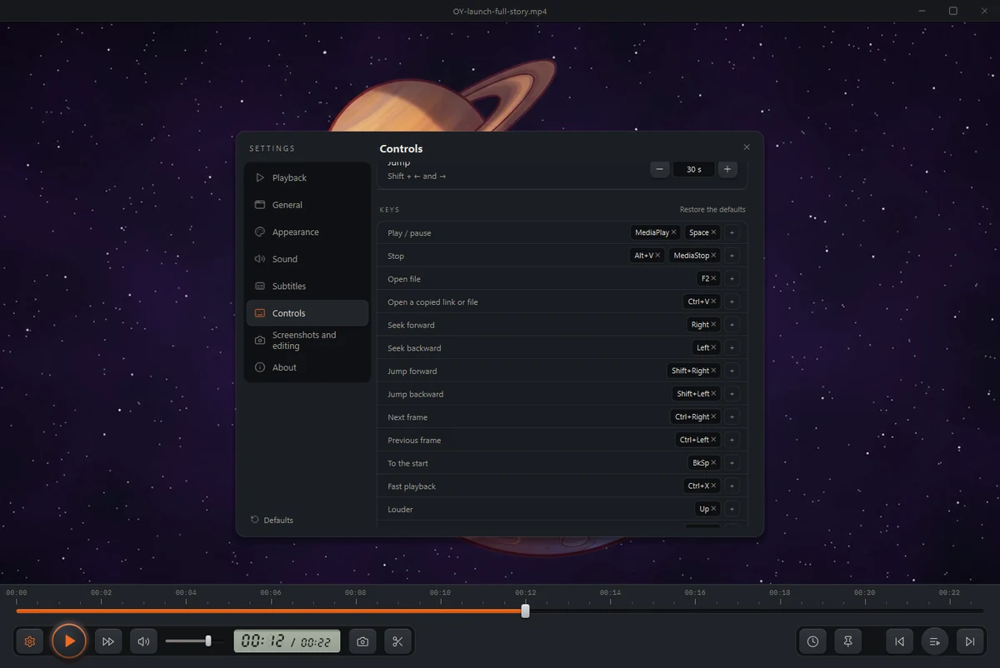
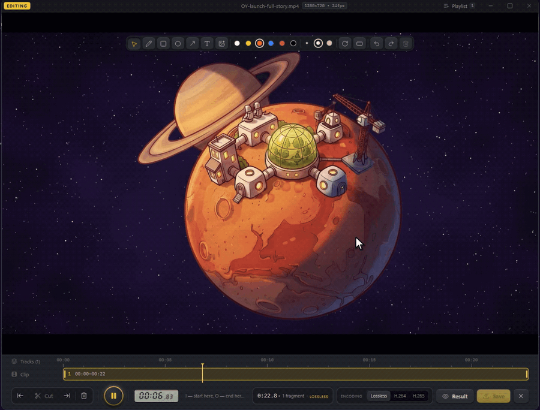
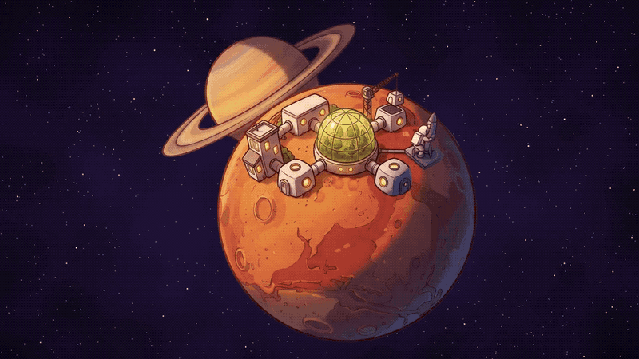

# OY Player

A free video player for Windows 10 and 11 that also cuts and annotates.

**[Download](https://github.com/electronic-mars/OY/releases/latest)** · [Website](https://electronic-mars.github.io/#oy-player) · [Ways to say thanks](https://electronic-mars.github.io/#support)


> **Status:** stable release (see the latest version on the Releases page). The interface is in 39 languages (as Windows speaks, or chosen in the settings). See [CHANGELOG.md](CHANGELOG.md).

## What it does

- **Watch.** Local files and streams through libmpv, with hardware decoding. A frame of where you would land shows above the seek bar; **Ctrl+X** plays fast, **Q** shows the decoder and other technical details.
- **Series.** Open one episode and the next ones, named the same but for the number, line up after it in the playlist.
- **Skip the opening and credits.** Mark them once (**Alt+E** and **Shift+E** for the opening, **Shift+O** for the credits); from then on they are skipped in every file of that folder of about the same length.
- **Cut.** Press **Ctrl+E**, then **I** and **O** to cut off the start and the end, **X** to split, **Delete** to take a piece out. Saving copies the streams without re-encoding where it can. Pieces from several files make one video, and an upright phone video can sit in a 16:9 frame over a blurred copy of itself.
- **Draw.** A pencil, rectangles, circles, arrows, text and pictures over the video, in six inks and three widths. Each drawing has its own time on the timeline, and saving puts them into the clip.
- **A key for every command**, and any of them can be changed in Settings › Controls › Keys.
- **39 languages.** In Arabic, Persian and Hebrew the window mirrors.
- **No ads, no telemetry, no account.** Once a day it looks for a new version and installs it only when you press «Update and restart». Licensed under the [GNU GPL v3](LICENSE).

| Open one episode, the next ones line up | Mark the opening and credits once |
|---|---|
|  |  |
| **A phone video becomes a widescreen one** | **A key for every command, and you can change any** |
|  |  |





**[Everything it does, with the key for each →](FEATURES.md)**

## Download

Installers are attached to the [GitHub releases](https://github.com/electronic-mars/OY/releases). The installer is per-user and needs no administrator rights. It is not code-signed yet, so Windows SmartScreen will ask for confirmation on first start. After that the player updates itself: when a new version is out, About › Update and restart installs it.

## Build from source

Needs Windows 10 or 11, Python 3.14, and:

- `vendor/mpv/libmpv-2.dll` from a [shinchiro mpv build](https://github.com/shinchiro/mpv-winbuild-cmake);
- `ffmpeg` and `ffprobe` on the PATH (the build looks in `C:\ProgramData\chocolatey\lib\ffmpeg\tools\ffmpeg\bin` or `OY_FFMPEG_DIR`);
- for the installer, Inno Setup 6.

```bash
python -m venv .venv
.venv\Scripts\pip install -r requirements.txt -r requirements-build.txt
OYPlayer.cmd
tools\build.cmd
```

`OYPlayer.cmd` runs the player from source; `tools\build.cmd` builds `dist\OYPlayer\` and the installer.

## Ways to say thanks

OY Player is free and made by one developer in their spare time. If it saves you time, there are a few ways to help it grow:

**[Ways to say thanks →](https://electronic-mars.github.io/#support)**

A star on GitHub, a bug report or an idea in the [issues](https://github.com/electronic-mars/OY/issues) is thanks too.

## Third-party components

FFmpeg, libmpv, Qt and others are listed with their licences and sources in [THIRD-PARTY-NOTICES.md](THIRD-PARTY-NOTICES.md).
